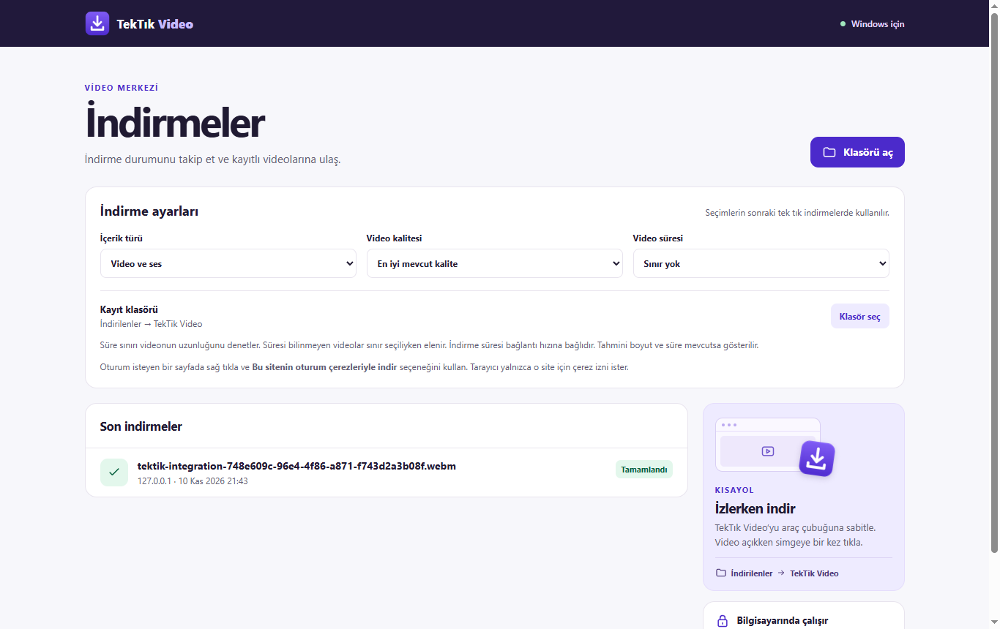

# TekTık Video

TekTık Video, Chrome ve Edge için bir Windows video indiricisidir. Eklenti simgesine bastığında açık sayfanın adresi bilgisayarındaki yerel yardımcıya iletilir ve indirme hemen başlar. Dosyalar Windows'un **İndirilenler → TekTik Video** klasörüne kaydedilir.

## İlk kurulum

1. Windows x64 üzerinde [Kur.bat](Kur.bat) dosyasını çalıştır. Kurulum yönetici yetkisi istemez. İlk seferde yt-dlp, Deno ve FFmpeg için yaklaşık 180 MB indirir ve dosyaların SHA-256 değerlerini GitHub sürüm bilgileriyle karşılaştırır.
2. Chrome'da `chrome://extensions`, Edge'de `edge://extensions` sayfasını aç. **Geliştirici modu** seçeneğini etkinleştir.
3. **Paketlenmemiş öğe yükle** seçeneğine tıkla ve bu projenin içindeki **`extension`** klasörünü seç. Tarayıcının uzantılar menüsünden **TekTık Video** simgesini araç çubuğuna sabitle.

## Kullanım

1. İndirme iznin olan bir videoyu aç ve araç çubuğundaki **TekTık Video** simgesine bir kez bas.
2. İlerlemeyi simge rozetinden takip et. Simgeye sağ tıklayıp **İndirmeleri göster** seçeneğini açarak durumu görebilir ve kayıt klasörüne gidebilirsin. Bir video veya video bağlantısına sağ tıklayarak da indirmeyi başlatabilirsin.

Bir bağlantıyı kopyaladıysan **İndirmeleri göster** ekranındaki alana yapıştırıp **MP3** veya **Video** seçerek indirebilirsin. YouTube Music tek parça bağlantıları ses dosyası olarak işlenir. yt-dlp'nin desteklediği erişilebilir SoundCloud ve Bandcamp parça bağlantıları da denenebilir; site desteği değişebilir. Çalma listesi yerine tek parça bağlantısı kullan.

Spotify bağlantılarından ses dosyası indirilemez. Uygulama bu bağlantılar için açıklayıcı bir hata gösterir; Spotify içeriğini çevrimdışı dinlemek için Spotify'ın kendi özelliğini kullan.

**İndirmeleri göster** ekranında sonraki indirmeler için video kalitesini, yalnızca ses (MP3) seçimini, en uzun video süresini ve kayıt klasörünü ayarlayabilirsin. Varsayılan seçim en iyi mevcut kalite, video ve ses, sınırsız video süresi ve İndirilenler klasörüdür. Süre sınırı seçildiğinde süresini bildirmeyen videolar da elenir. Video süresi ile tahmini dosya boyutu kaynak tarafından sağlanırsa indirme satırında gösterilir. Dosya boyutu tahmini kesin bir indirme kotası değildir.

Oturum isteyen bir sitede video sayfasına sağ tıklayıp **Bu sitenin oturum çerezleriyle indir** seçeneğini kullanabilirsin. Tarayıcı ilgili site için çerez erişim izni ister. Bu işlem site oturumunu yalnızca o indirmede yerel yardımcıya aktarır. Çerezler geçici dosyada tutulur ve işlem sonunda silinir. Oturumla indirme bazı sitelerde yine başarısız olabilir.

## Destek kapsamı

- Açık sekmedeki YouTube video ve Shorts adresleri.
- Doğrudan video dosyaları ve yt-dlp'nin desteklediği herkese açık video sayfaları.
- Chrome ve Edge'de Windows x64 kullanımı.

YouTube desteği site değişikliklerinden ve videonun erişim durumundan etkilenebilir. Canlı yayınlar ve DRM korumalı içerikler desteklenmez. Yalnızca indirmene izin verilen içerikleri indir. [YouTube Hizmet Şartları](https://www.youtube.com/t/terms)

İndirme bağlantısı, yalnızca tıklama üzerine tarayıcıdan yerel yardımcıya aktarılır. Video kendi kaynağından indirilir. Eklenti geniş site izni istemez. İndirme geçmişinde video adresi yerine site adı, başlık, durum ve dosya bilgisi görünür. İndirme sürerken tarayıcıyı açık tut.

## Güncelleme ve kaldırma

- İndirmeler bittikten sonra `Kur.bat` dosyasını yeniden çalıştırarak yerel yardımcıyı ve indirme bileşenlerini güncelle. Eklenti dosyaları değiştiyse tarayıcının uzantılar sayfasından **Yeniden yükle** düğmesine bas.
- Kaldırmak için önce tarayıcıdan uzantıyı kaldır, ardından bu klasörde PowerShell açıp `.\Kur.bat -Kaldir` komutunu çalıştır. İndirilen videoları Windows'taki kayıt klasöründe bulabilirsin.

## Lisans

Bu deponun kaynak kodu [MIT lisansı](LICENSE) ile yayımlanır. Kurulum sırasında indirilen yt-dlp, Deno ve FFmpeg kendi lisanslarına tabidir.
